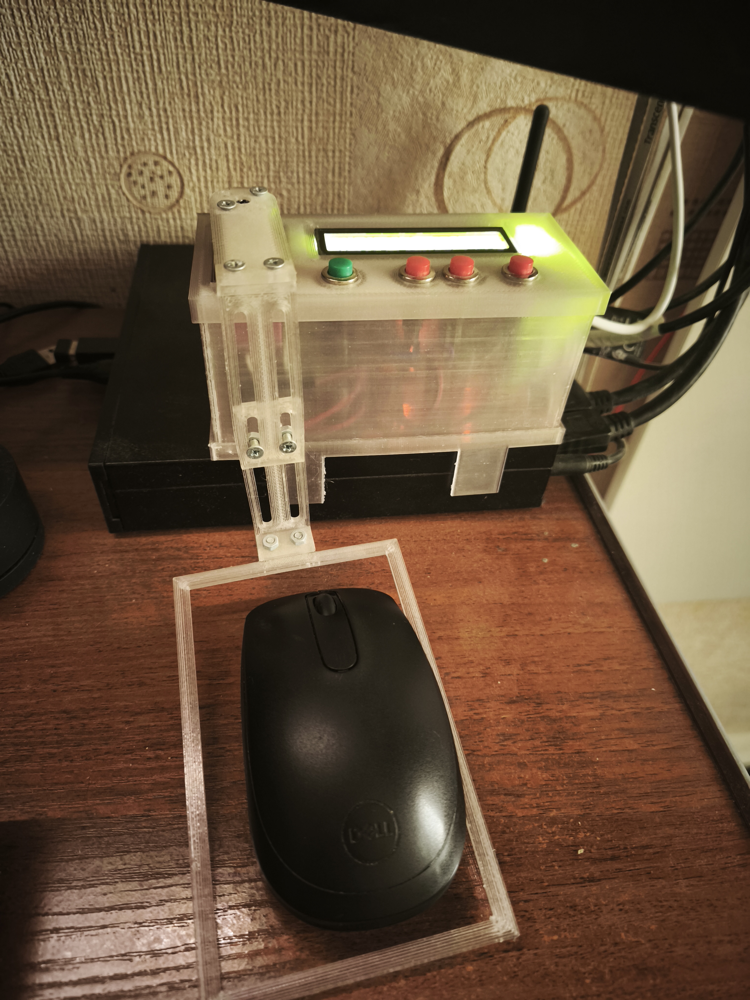
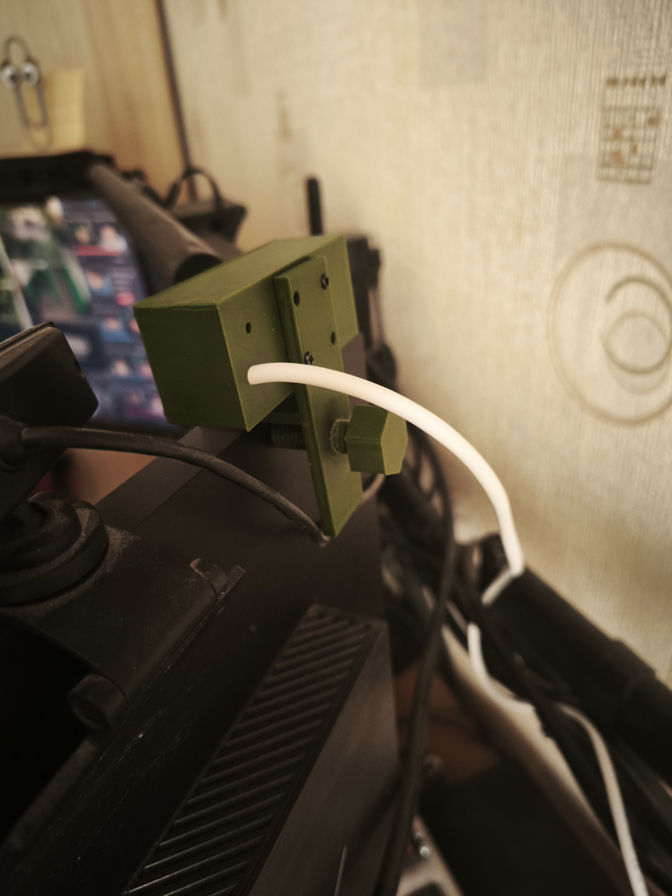
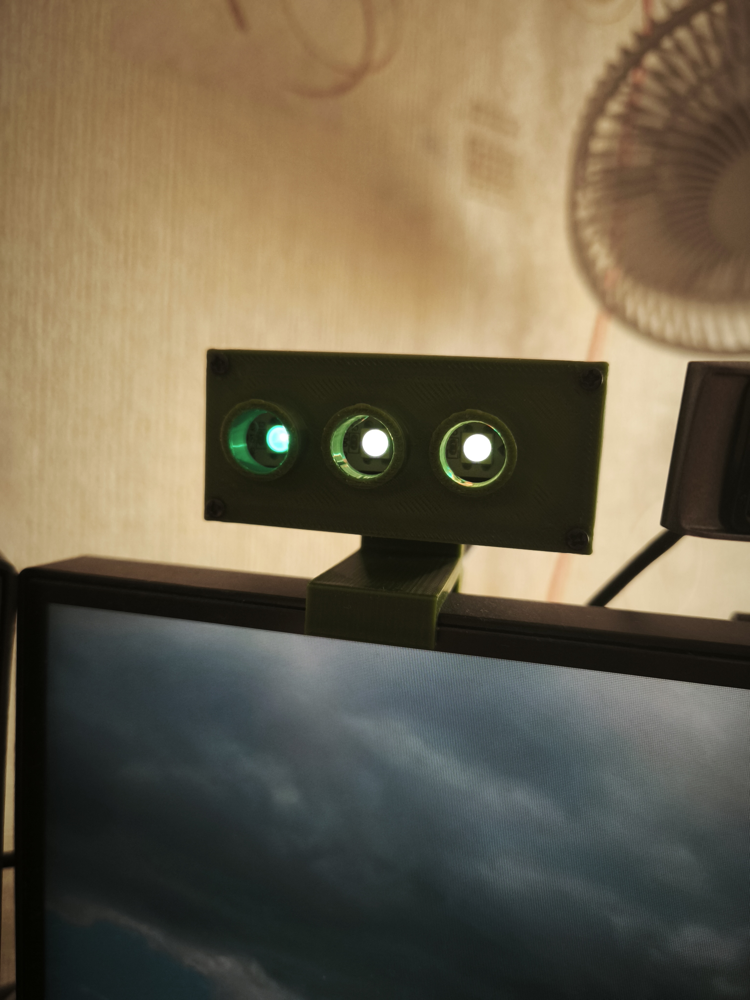
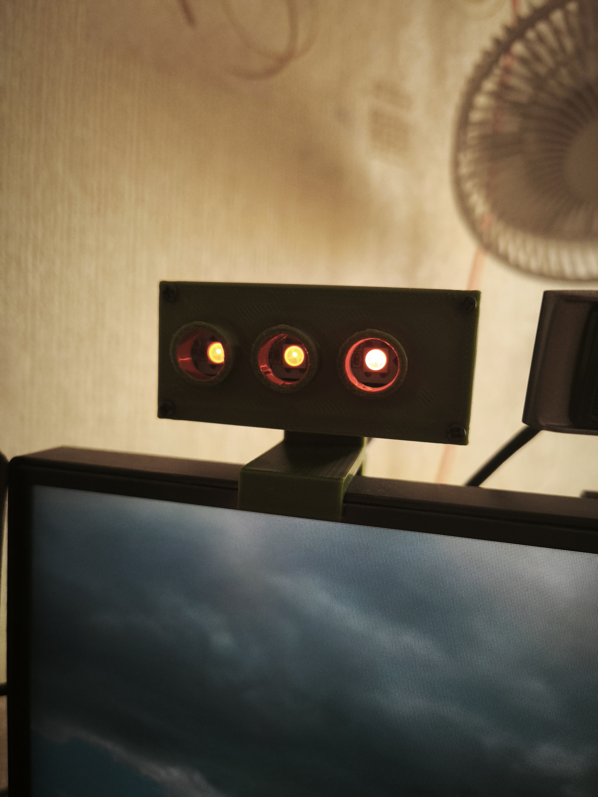
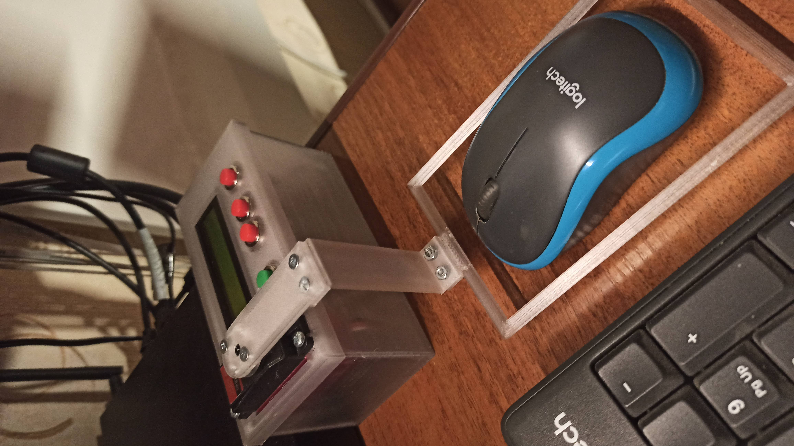
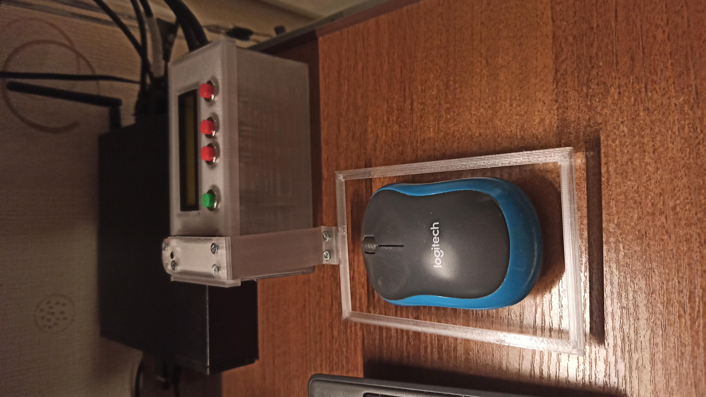
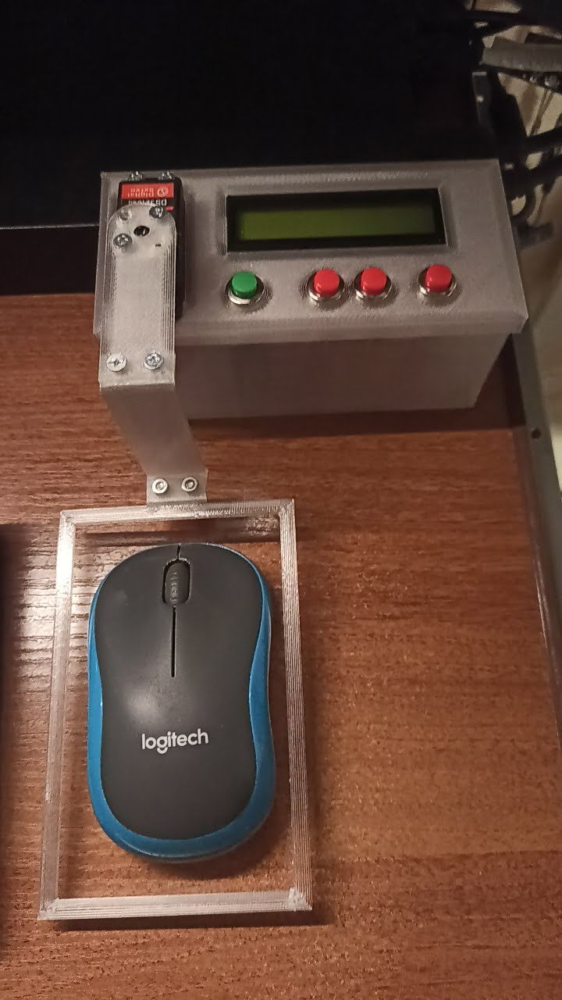

# AI Helper

ESP32 firmware that gives coding agents (Claude Code, GitHub Copilot, ...) a physical presence on the desk: an RGB **status semaphore** (LED + buzzer) that shows what the agent is currently doing, plus an optional **mouse mover** (servo + LCD) that keeps the workstation awake during long runs.

Both modules share one ESPHome codebase and can be flashed together on one board or as two independent devices.

## Video

[](https://youtu.be/Ve-P4YmRdPM)

---

## Hardware

3D-printable enclosure parts are in [`stl/`](stl/):

- `MMBottom.stl` / `MMTop.stl` — mouse mover enclosure base and lid
- `MMHPart1.stl` .. `MMHPart4.stl`, `MMHPart2Long.stl` — mover arm/horn segments (use `MMHPart2Long.stl` instead of `MMHPart2.stl` for the extended-reach variant)
- `Semaphor - Holder.stl`, `Semaphor - Sem Bottom.stl`, `Semaphor - Sem Top.stl`, `Semaphor - Screw.stl` — semaphore enclosure parts
- `A1M AI-Helper.3mf` — combined 3MF project file for the semaphore parts

Common electronics for both modules:

- ESP32 dev board (esp-idf framework)
- Semaphore: WS2812 4-LED strip (`GPIO26`), passive buzzer via LEDC PWM (`GPIO25`, channel 2)
- Mouse mover: SG90-class servo (`GPIO23`, LEDC channel 0), 16x2 LCD over I2C (`GPIO21`/`GPIO22`, PCF8574 backpack), 4 push buttons (OK/Up/Down/Right), built-in blue status LED (`GPIO2`)

---

## Project layout

| File | Purpose |
|---|---|
| [`ai-helper.yaml`](ai-helper.yaml) | Combined build — both modules on one ESP32 (`ai-helper` device) |
| [`semaphore-device.yaml`](semaphore-device.yaml) | Standalone semaphore-only build (`ai-semaphore` device) |
| [`mouse-mover-device.yaml`](mouse-mover-device.yaml) | Standalone mouse-mover-only build (`mouse-mover` device) |
| [`ai-helper-common.yaml`](ai-helper-common.yaml) | Shared package: logger, OTA, time, WiFi/AP, captive portal, web server, `http_request`, WiFi RSSI sensor |
| [`ai-helper-defaults.yaml`](ai-helper-defaults.yaml) | Shared substitutions: brightness/buzzer ranges, color and LED-assignment option lists |
| [`ai-helper-semaphore.yaml`](ai-helper-semaphore.yaml) / [`.h`](ai-helper-semaphore.h) | Semaphore module: status LED, buzzer, per-status color/brightness/buzzer config, webhook buttons |
| [`ai-helper-mouse-mover.yaml`](ai-helper-mouse-mover.yaml) / [`.h`](ai-helper-mouse-mover.h) | Mouse mover module: servo sweep, LCD menu, random.org-seeded randomization |
| [`ai-helper-mouse-mover-defaults.yaml`](ai-helper-mouse-mover-defaults.yaml) | Mouse mover substitutions: pins, angle/step/delay ranges, timing |
| [`claude-hooks/`](claude-hooks/) | Claude Code **user-level** hooks for the semaphore (status light + usage gauge): scripts, `settings-hooks.json`, `install.ps1` — see [Claude Code](#claude-code) |
| [`copilot-hooks/`](copilot-hooks/) | GitHub Copilot **user-level** hooks for the semaphore (status light, reusing the same status script): `ai-helper.json`, `install.ps1` — see [GitHub Copilot](#github-copilot) |
| `secrets.yaml` | WiFi/MQTT credentials (not committed) |

Both device modules are compiled behind `platformio_options.build_flags` (`AI_HELPER_SEMAPHORE_BUILD_ENABLED`, `AI_HELPER_MOUSE_MOVER_BUILD_ENABLED`), so the combined `ai-helper.yaml` build includes both; the standalone YAMLs each enable only one.

---

## Semaphore module

Shows the AI agent's current phase via an RGB LED (one of 3 physical positions: Red/Yellow/Green segment) and an optional buzzer beep.

Status states: `Idle`, `Reasoning`, `Done`, `Need User Action`, `Allow Action`, `Custom1`, `Custom2`. Each status has independently configurable LED color, LED position, brightness, and buzzer (enable/frequency/duration).

Status can be changed:

- From Home Assistant, via the `AI Status` select entity
- Over the native API, via the `set_ai_status` action (also `claude_status_hook` / `copilot_status_hook`, kept as aliases)
- Over HTTP, by POSTing to the ESPHome web server's button-press REST endpoint (this is what the [Webhook setup](#webhook-setup-for-claude-code-and-copilot) below uses):

  ```
  POST http://<device-ip>/button/webhook_<status>/press
  ```

  where `<status>` is one of `idle`, `reasoning`, `done`, `need_user_action`, `allow_action`, `custom1`, `custom2`.

## Mouse mover module

Sweeps a servo horn back and forth on a timer to simulate mouse activity, with an LCD showing live state and physical buttons for setup.

- Configurable start/end/max angle, step size, step delay, and sweep period, each with min/max bounds enforced via the `number` entities
- `Use random.org` switch: when enabled, refreshed values (angle/step/delay/period) are pulled from random.org over HTTPS; falls back to local pseudo-random values on request failure or when offline
- LCD menu: short-press OK/Right for quick actions, long-press to toggle enable; Up/Down enter a bound-editing mode to set start/end angle live from the servo's current position
- Compile-time disable via `AI_HELPER_MOUSE_MOVER_BUILD_ENABLED=0` still allows the runtime switch to exist but forces it off

---

## Webhook setup for Claude Code and Copilot

The semaphore exposes one HTTP endpoint per status via ESPHome's built-in web server (`web_server: port: 80`, enabled in [`ai-helper-common.yaml`](ai-helper-common.yaml)). No Home Assistant is required.

```
POST http://<device-ip>/button/webhook_<status>/press
```

Replace `<device-ip>` with the semaphore's IP (find it in your router/DHCP leases, or use the ESPHome dashboard). This repo's example scripts point at `172.16.1.15`.

### Available webhook statuses

These endpoints exist regardless of which agent calls them:

| Endpoint | Resulting status | When to trigger it |
|---|---|---|
| `POST /button/webhook_idle/press` | `Idle` | Reset/clear, no active session |
| `POST /button/webhook_reasoning/press` | `Reasoning` | Agent starts active work: reading, planning, editing, compiling, testing, debugging |
| `POST /button/webhook_need_user_action/press` | `Need User Action` | Agent needs missing info, manual verification, flashing, physical checks, or secrets from the user |
| `POST /button/webhook_allow_action/press` | `Allow Action` | Agent needs approval for a risky/consequential action, or permission to read outside the workspace |
| `POST /button/webhook_done/press` | `Done` | Requested work is complete and the agent is about to send its final response |
| `POST /button/webhook_custom1/press` | `Custom1` | Free-form, project-defined use |
| `POST /button/webhook_custom2/press` | `Custom2` | Free-form, project-defined use |

Both agent integrations below just decide *when* to hit which of these endpoints.

### Remaining-usage gauge

Besides the status semaphore, the device exposes a **`Usage Remaining`** percentage (0-100 %) number entity. Agents push it over the same web-server REST API, addressing the entity by its URL-encoded name:

```
POST http://<device-ip>/number/AI%20Helper%20Usage%20Remaining/set?value=<0-100>
```

It's a `number` (not a `sensor`) because ESPHome's web server can only *set* controllable entities over HTTP — `sensor` entities are read-only — but it still displays as a percentage readout in the Home Assistant UI and on the device's own web page.

Alongside it, a **`Usage Source`** text entity records which tool is currently driving the gauge. Agents should update **both** `Usage Source` and `Usage Remaining` at the **start of reasoning** and again at **done**:

```
POST http://<device-ip>/text/AI%20Helper%20Usage%20Source/set?value=Claude%20Code
```

- **Claude Code** reports the real **plan usage** automatically via `ai-helper-usage-sync.ps1` (user level, `~/.claude/hooks/ai-helper/`, see [Claude Code](#claude-code)), updating **both** `Usage Remaining` and `Usage Source` at the **start of reasoning** (`UserPromptSubmit`) and again at **`Stop`**. The live "N% used, resets in ..." figure is not exposed to hooks, persisted to disk, or available via any CLI — it lives only in Anthropic's `anthropic-ratelimit-unified-*` response headers. So the hook reproduces what the Claude Code UI does: it makes one minimal authenticated request using the OAuth token in `~/.claude/.credentials.json`, reads `anthropic-ratelimit-unified-5h-utilization`, and posts `100 * (1 - utilization)` (plus the source tag). `-Window 5h` (default) mirrors the UI's "Current session" bar; `-Window 7d` is the weekly window. `-Mode source` is a lightweight variant that skips the API ping and only tags the source (not wired to any hook at the moment). Use `-Override <percent>` to post a fixed value instead. On any failure (offline, expired token) the gauge keeps its previous value rather than showing a wrong one.

  > Note: this uses your stored Claude credentials to make one tiny extra request per turn, and relies on undocumented rate-limit headers that Anthropic could change.

- **GitHub Copilot** has its own separate quota (not Claude's) with no equivalent hook-accessible usage feed, so there is **no automatic gauge for it**. `.github/copilot-instructions.md` used to tell Copilot to post a best-effort estimate tagged `Usage Source = GitHub Copilot`; those instructions were removed (`c36fc19`), so today it can only be set by hand with the REST calls above (see [GitHub Copilot](#github-copilot)).

### Claude Code

Claude Code hooks are **user level** since 2026-11-16: they are defined in `~/.claude/settings.json` and the scripts live in `~/.claude/hooks/ai-helper/` (with their own README: event mapping, payload filters, rules for editing the commands). Every repo and the desktop app's Code tab use that one copy, so this repo no longer has a `.claude/settings.json` or `.github/hooks/` for them. Do not add them back: user and project hooks both run, so each event would fire twice. The scripts translate hook events into webhook calls.

**This repo is the source of truth: [`claude-hooks/`](claude-hooks/)** holds the scripts, the hook definition (`settings-hooks.json`) and an installer. After a Windows reinstall or on a new PC, clone the repo and run:

```powershell
powershell -NoProfile -ExecutionPolicy Bypass -File ai-helper\claude-hooks\install.ps1
```

In VS Code the same thing is a task: **Terminal → Run Task… → `AI Helper: install Claude hooks`** (and `AI Helper: check Claude hooks (no changes)` for the read-only check), defined in [`.vscode/tasks.json`](../.vscode/tasks.json). The installer copies the scripts to `~/.claude/hooks/ai-helper/` and merges the hooks into `~/.claude/settings.json`, keeping every other setting and hook (previous files go to `~/.claude/backups/ai-helper-install-<time>/`). It is safe to run again; `install.ps1 -Check` only reports differences (exit code 1 = not in sync). To change a hook, edit the files in `claude-hooks/`, run `install.ps1`, and restart the Claude session.

1. Confirm the semaphore IP in [`claude-hooks/ai-helper-status-sync.ps1`](claude-hooks/ai-helper-status-sync.ps1) (`$uri` line) matches your device, then run `install.ps1`.
2. The user-level settings wire the events like this:

   | Claude Code hook | `-Mode` | Resulting status |
   |---|---|---|
   | `UserPromptSubmit`, `PostToolUse` | `reasoning` | `Reasoning` |
   | `PreToolUse` (matcher: `AskUserQuestion\|ExitPlanMode\|ask_user\|exit_plan_mode`) | `need_user_action` | `Need User Action` |
   | `Notification` (matcher: `permission_prompt`) | `allow_action` | `Allow Action` |
   | `Notification` (matcher: `elicitation_dialog`) | `need_user_action` | `Need User Action` |
   | `Stop` | `classify-stop` | inferred from the final assistant message (see below) |

3. `classify-stop` mode reads the hook JSON payload from stdin, extracts the last assistant message, and pattern-matches it: mentions of asking permission → `Allow Action`, mentions of a manual step needed from the user → `Need User Action`, otherwise → `Done`.
4. The script is defensive by design — any HTTP failure is swallowed and it always exits 0, so a semaphore outage never blocks an agent turn. Each run appends one line to `%TEMP%\ai-helper-status-hooks\hook.log`. The hook commands have a few hard rules (single-quoted `-Command`, no `PermissionRequest`, `; exit 0`); see [`claude-hooks/README.md`](claude-hooks/README.md) before editing them.

In addition to the status wiring above, the user-level settings also run `ai-helper-usage-sync.ps1` on two events (see [Remaining-usage gauge](#remaining-usage-gauge)):

| Claude Code hook | Args | Effect |
|---|---|---|
| `UserPromptSubmit` | *(default)* | Query rate-limit headers → post `Usage Remaining` % **and** tag `Usage Source = Claude Code` |
| `Stop` | *(default)* | Same full update again with the end-of-turn figure |

### GitHub Copilot

Copilot (CLI and the desktop app) gets the same status light through its own **user-level** hooks: Copilot loads every `*.json` from `~/.copilot/hooks/` (or `$COPILOT_HOME/hooks/`), so [`copilot-hooks/ai-helper.json`](copilot-hooks/ai-helper.json) is installed there and runs in every repo. It calls the **same** `ai-helper-status-sync.ps1` (the installer copies it from `claude-hooks/` to `~/.copilot/hooks/ai-helper/`), so one script serves both agents. It is a separate pipeline from the Claude hooks — Copilot does not read `~/.claude/settings.json` and Claude does not read `~/.copilot/hooks/` — so nothing fires twice. Install it with:

```powershell
powershell -NoProfile -ExecutionPolicy Bypass -File ai-helper\copilot-hooks\install.ps1
```

or the VS Code task **`AI Helper: install Copilot hooks`** (plus `AI Helper: check Copilot hooks (no changes)` for the read-only check), then restart the Copilot session. Event mapping and the deliberate differences from the Claude wiring (no `PreToolUse` hook, `Stop` lands on `Done`, no usage sync) are documented in [`copilot-hooks/README.md`](copilot-hooks/README.md). After a Copilot session the shared `%TEMP%\ai-helper-status-hooks\hook.log` shows the runs as `[other]` lines.

There is no other Copilot integration: [`.github/copilot-instructions.md`](../.github/copilot-instructions.md) is empty (the manual `curl.exe` status/usage protocol was removed as outdated in `c36fc19`). The webhooks can still be pressed by hand:

```cmd
curl.exe -s -o NUL -X POST -d "" "http://172.16.1.15/button/webhook_reasoning/press"
curl.exe -s -o NUL -X POST -d "" "http://172.16.1.15/button/webhook_need_user_action/press"
curl.exe -s -o NUL -X POST -d "" "http://172.16.1.15/button/webhook_allow_action/press"
curl.exe -s -o NUL -X POST -d "" "http://172.16.1.15/button/webhook_done/press"
curl.exe -s -o NUL -X POST -d "" "http://172.16.1.15/button/webhook_idle/press"
```

The user-level `ai-helper-usage-sync.ps1` reports the **Claude** plan, so it deliberately does nothing in a Copilot session (it exits unless `CLAUDE_PROJECT_DIR`/`CLAUDECODE` is set, or `-Override` is given). Nothing sets the gauge for Copilot automatically.

To point the integration at your own device, replace `172.16.1.15` in `ai-helper-status-sync.ps1` and `ai-helper-usage-sync.ps1` (in `claude-hooks/`), then run both installers (`claude-hooks\install.ps1` and `copilot-hooks\install.ps1`).

---

## Build / Flash

```cmd
cd d:\esphome\ai-helper
esphome run ai-helper.yaml
```

Or flash a single module only:

```cmd
esphome run semaphore-device.yaml
esphome run mouse-mover-device.yaml
```

Config-only validation:

```cmd
esphome config ai-helper.yaml
```

## Required secrets

`secrets.yaml` in this folder (not committed):

```yaml
wifi_ssid: "Your_SSID"
wifi_password: "Your_WiFi_Password"
```

---

## Photos
















Mouse mover in action: [`VID_20240801_203023.mp4`](photo/VID_20240801_203023.mp4), [`VID_20240801_203426.mp4`](photo/VID_20240801_203426.mp4)
