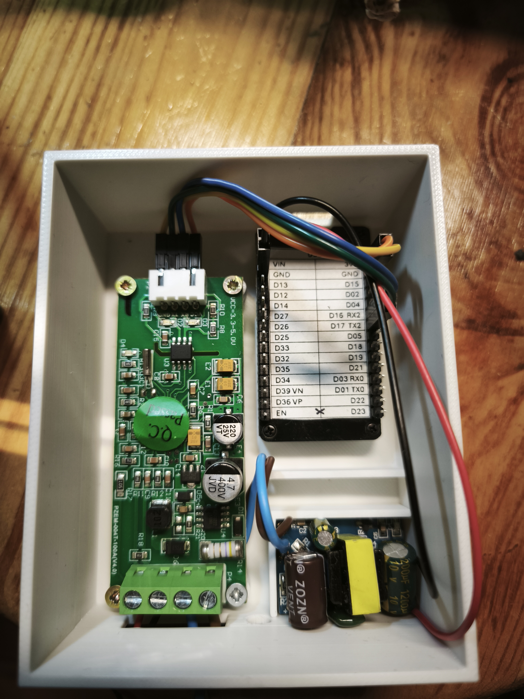
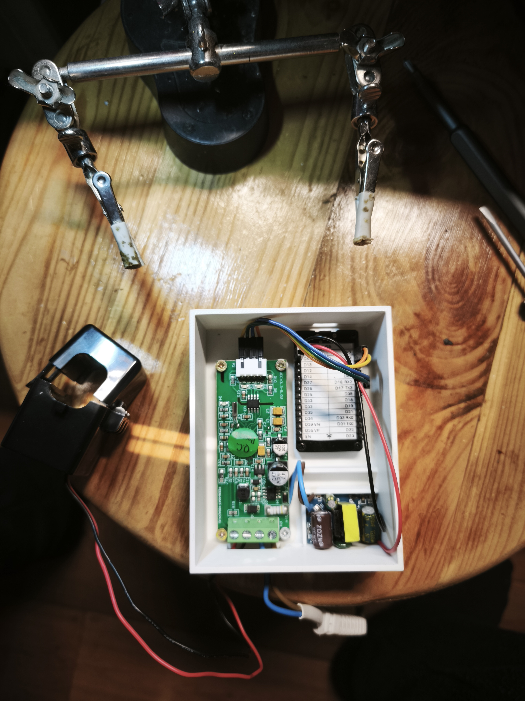
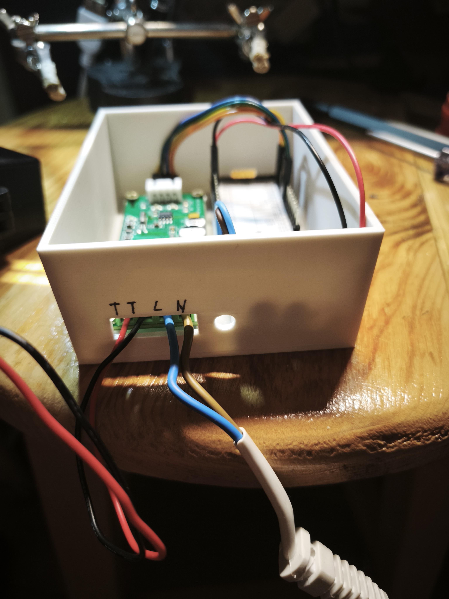
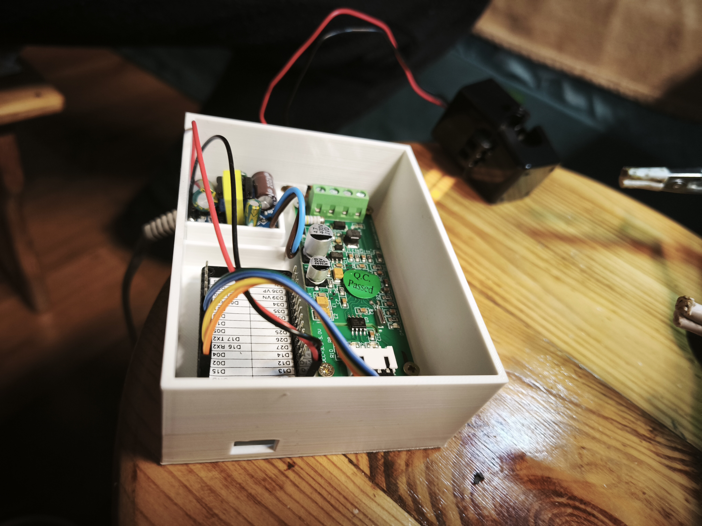
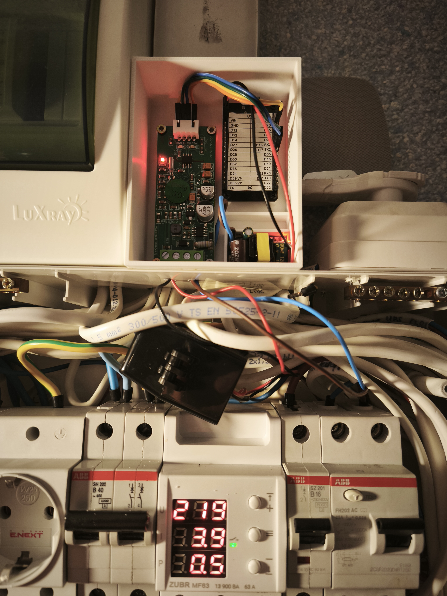
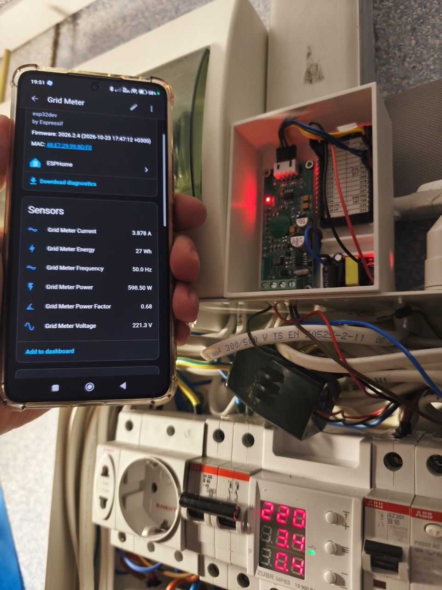

# Grid Meter

ESP32 + PZEM-004T (AC, Modbus over UART) mains meter for Home Assistant. Reports voltage, current, power, energy, frequency and power factor.

The PZEM-004T is powered from the measured mains line, so when the grid drops it stops answering and ESPHome would otherwise keep showing the last reading. If no PZEM reply arrives for 5 s, **all six PZEM values are published as 0**. They resume with the first real reply.

|  |  |
|---|---|
| Inside the box: PZEM-004T (left), ESP32 (top right), AC-DC supply module (bottom right) | The same box next to the split-core current clamp that goes around the measured conductor |

|  |  |
|---|---|
| Cable entry in the front wall, marked `T T L N`: current clamp leads (T T) and mains (L N) | Angled view of the wired box |

|  |  |
|---|---|
| Installed in the electrical panel, with the current clamp on the panel wiring above the breakers | Live readings on the device page in the Home Assistant app: current, energy, frequency, power, power factor and voltage |

---

## Hardware

- ESP32 dev board (esp-idf framework)
- PZEM-004T-100A AC module (board marked V4.0) with an external split-core current clamp, on UART (9600 baud)

| ESP32 | PZEM-004T |
|---|---|
| `GPIO16` (RX) | TX |
| `GPIO17` (TX) | RX |

Pins and timing are substitutions at the top of [`grid-meter-pzem.yaml`](grid-meter-pzem.yaml).

3D-printable enclosure parts are in [`stl/`](stl/):

- `GridMeter - Bottom.stl` — box with compartments for the PZEM, the ESP32 and the supply module, and the cable openings in the front wall
- `GridMeter - Top.stl` — lid
- `A1M GridMeter Box.3mf` — combined 3MF project file for both parts

---

## Project layout

| File | Purpose |
|---|---|
| [`grid-meter-device.yaml`](grid-meter-device.yaml) | Entry file: identity substitutions, board, composes the packages |
| [`grid-meter-common.yaml`](grid-meter-common.yaml) | Shared base: logger, debug, OTA, time, WiFi/AP, captive portal, Restart Device and WiFi Forget buttons, web server, `http_request`, WiFi RSSI / Channel / Name and Reset Reason diagnostics |
| [`grid-meter-pzem.yaml`](grid-meter-pzem.yaml) | UART, PZEM-004T sensors (staggered publish throttles), 1 s stale-check interval |
| [`grid-meter-pzem.h`](grid-meter-pzem.h) | C++ helpers: last-reply tracking, freshness check, zeroing |
| `secrets.yaml` | Not used; WiFi is set through the captive portal |

---

## Zero-on-stale behaviour

- The voltage sensor's `on_value` records the time of the last PZEM reply (`pzem_last_rx_ms`).
- Every 1 s, `zero_pzem_sensors_if_stale()` publishes `0` for voltage, current, power, energy, frequency and power factor if the last reply is older than `pzem_stale_timeout_ms` (default `5000`).
- After boot, the PZEM gets the same 5 s to answer before anything is zeroed.
- Energy is zeroed too. It is a `total_increasing` sensor, so Home Assistant sees the drop to 0 as a counter reset and the next real reading as a jump. To keep the last energy value instead, remove the `pzem_energy` line from `zero_pzem_sensors_if_stale()`.

---

## Build

```cmd
esphome config grid-meter/grid-meter-device.yaml
esphome run grid-meter/grid-meter-device.yaml
```

First flash over USB, then OTA. On a fresh device, join the `AP-Grid-Meter` access point and enter your WiFi in the captive portal.
